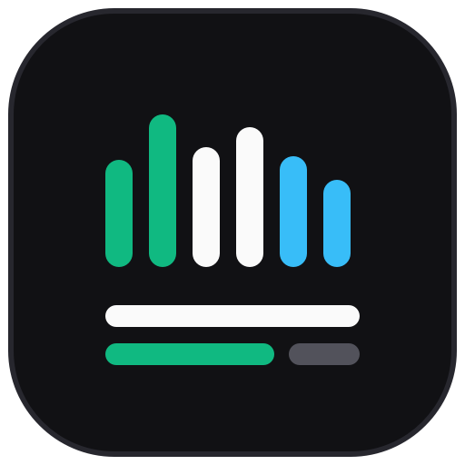
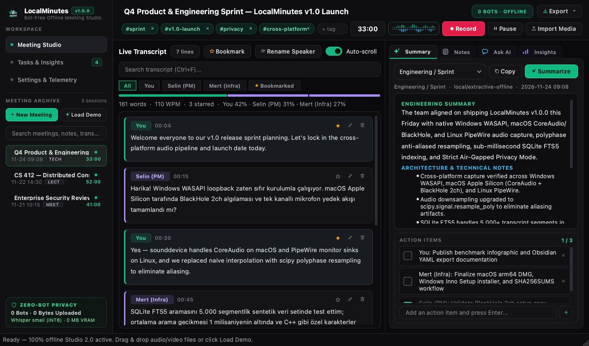
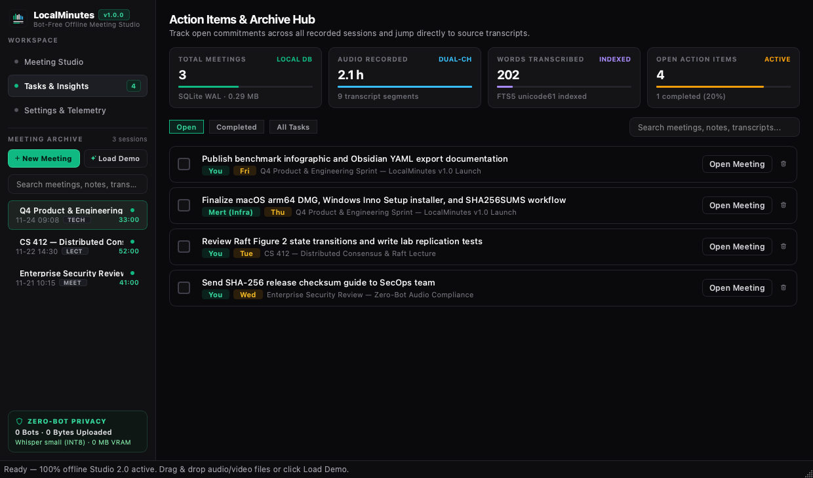
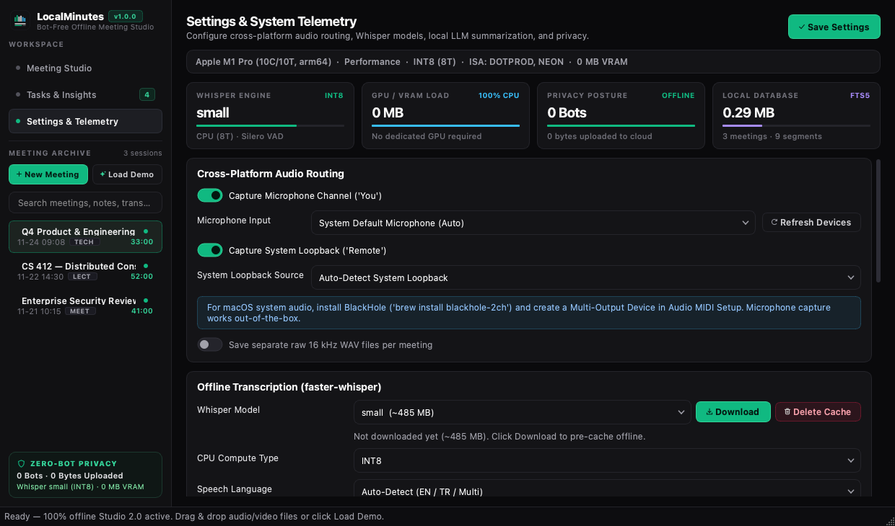
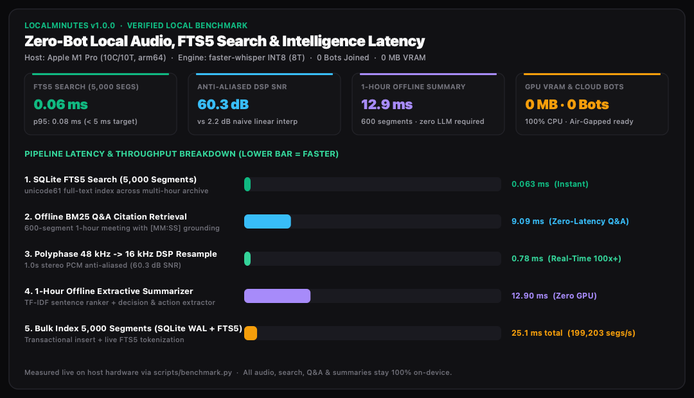
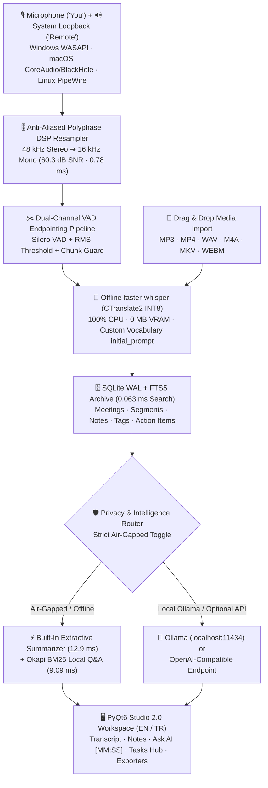

<div align="center">



# 🎙️ LocalMinutes — 100% Offline, Bot-Free Meeting & Lecture Studio

**🇬🇧 English (Active)** · **🇹🇷 [Türkçe README](README.tr.md)** · **[🔌 Compatibility Matrix](COMPATIBILITY.md)** · **[🤝 Contributing](CONTRIBUTING.md)** · **[🛡️ Security & Privacy](SECURITY.md)** · **[📜 Changelog](CHANGELOG.md)**

**Record Zoom, Teams, Google Meet, Discord, or university lectures with ZERO meeting bots — 100% offline `faster-whisper` INT8 transcription (`0 MB VRAM`), Granola-style notes, persistent action items, instant local Q&A with `[MM:SS]` citations, and sub-millisecond SQLite FTS5 search on Windows x64, macOS Apple Silicon, and Linux.**

[](https://localminutes.andacbasaran.com/)
[-2563EB?style=for-the-badge&logo=windows&logoColor=white)](https://localminutes.andacbasaran.com/downloads/LocalMinutes.exe)
[-18181B?style=for-the-badge&logo=apple&logoColor=white)](https://localminutes.andacbasaran.com/downloads/LocalMinutes-macOS.dmg)
[-E95420?style=for-the-badge&logo=linux&logoColor=white)](https://localminutes.andacbasaran.com/downloads/LocalMinutes-Linux.tar.gz)
[](https://github.com/Andacbasaran/LocalMinutes/releases/latest)

[](https://github.com/Andacbasaran/LocalMinutes/actions/workflows/ci.yml)
[](https://github.com/Andacbasaran/LocalMinutes/releases/latest)
[](https://github.com/Andacbasaran/LocalMinutes/releases)
[](https://github.com/Andacbasaran/LocalMinutes/stargazers)
[](https://www.python.org/)
[-41CD52?style=flat-square&logo=qt&logoColor=white)](https://pypi.org/project/PyQt6/)
[](https://github.com/SYSTRAN/faster-whisper)
[-10B981?style=flat-square)](#)
[](#)
[](LICENSE)

<br/>

[**✨ Why LocalMinutes?**](#-why-localminutes-v100-studio-20) · [**🖥️ Interface**](#️-application-interface) · [**⚖️ Comparison**](#️-how-it-compares) · [**🚀 Download & Install**](#-download--installation) · [**⌨️ Hotkeys**](#️-workflow--keyboard-shortcuts) · [**📊 Benchmarks**](#-performance-benchmarks) · [**🧠 Architecture**](#-system-architecture) · [**📂 Structure**](#-project-structure) · [**🗺️ Roadmap**](#️-roadmap)

</div>

---

## ✨ Why LocalMinutes? (v1.0.0 Studio 2.0)

**LocalMinutes** is a privacy-first, open-source alternative to **Granola**, **Fireflies.ai**, and **Otter.ai**. Instead of inviting an awkward cloud bot into your **Zoom**, **Microsoft Teams**, **Google Meet**, or **Discord** calls, LocalMinutes captures your microphone (`You`) and system audio (`Remote`) natively on your device, transcribes live on CPU with **`0 MB VRAM`**, and keeps every transcript, note, decision, and action item in a local SQLite FTS5 vault.

<table>
  <tr>
    <td width="50%">
      <b>🔇 Zero-Bot Dual-Channel Audio Capture (Win / macOS / Linux)</b><br/>
      Automatically separates <b>You</b> (microphone) and <b>Remote</b> (system loopback) across <b>Windows WASAPI</b> (zero drivers), <b>macOS CoreAudio + BlackHole 2ch</b>, and <b>Linux PipeWire / PulseAudio <code>.monitor</code></b>, powered by anti-aliased polyphase resampling (<code>60.3 dB</code> SNR, <code>0.78 ms</code>).
    </td>
    <td width="50%">
      <b>⚡ 100% Offline faster-whisper INT8 &amp; Media Import (0 MB VRAM)</b><br/>
      Hardware-adaptive CTranslate2 CPU engine with Silero VAD endpointing, <b>Custom Vocabulary (<code>initial_prompt</code>)</b> for technical jargon &amp; EN/TR code-switching, plus cancellable drag-and-drop import for <code>MP3</code>, <code>MP4</code>, <code>WAV</code>, <code>M4A</code>, <code>MKV</code>, and <code>WEBM</code>.
    </td>
  </tr>
  <tr>
    <td width="50%">
      <b>📝 Granola-Style Private Notes &amp; Cross-Meeting Tasks Hub</b><br/>
      Jot timestamped shorthand notes (<code>Ctrl+T</code>), click <b>Enhance My Notes</b> to weave transcript facts into your notes, and track every extracted commitment across all recorded sessions in the persisted <b>Tasks &amp; Insights Hub</b>.
    </td>
    <td width="50%">
      <b>💬 Ask This Meeting — Grounded Local Q&amp;A with <code>[MM:SS]</code> Citations</b><br/>
      Ask questions about decisions, blockers, or owners and jump straight to the exact spoken card via clickable <code>[MM:SS]</code> citations — instant <code>9.09 ms</code> offline <b>Okapi BM25</b> or optional local <b>Ollama</b> (<code>qwen2.5:7b</code>, <code>llama3.1</code>).
    </td>
  </tr>
  <tr>
    <td width="50%">
      <b>🛡️ Strict Air-Gapped Privacy Mode &amp; <code>0.063 ms</code> FTS5 Archive</b><br/>
      Flip one switch in Settings to enforce <b>0 outbound HTTP requests</b> across summaries, Q&amp;A, and updates. Search 5,000+ transcript segments (including <code>C++</code> and Turkish Unicode) in <code>0.063 ms</code> via SQLite WAL + FTS5.
    </td>
    <td width="50%">
      <b>📤 Obsidian YAML Markdown, WebVTT, SRT &amp; JSON Backups</b><br/>
      Export complete meeting packets with checkboxes, bookmarks, and YAML frontmatter for <b>Obsidian</b>, plus standard <b>Markdown</b>, <b>SubRip (<code>.srt</code>)</b>, <b>WebVTT (<code>.vtt</code>)</b>, <b>Plain Text</b>, and round-trip <b>JSON backups</b> — in a full bilingual <b>EN / TR</b> Studio 2.0 UI.
    </td>
  </tr>
</table>

---

## 🖥️ Application Interface

<div align="center">
  
</div>

<details>
<summary><b>📸 View More Screens (Tasks &amp; Archive Hub · Settings &amp; System Telemetry)</b></summary>
<br/>
<div align="center">
  <p><b>View 2 — Action Items &amp; Archive Hub (Cross-Meeting Task Tracker &amp; Jump to Transcript)</b></p>
  
  <br/><br/>
  <p><b>View 3 — Settings &amp; System Telemetry (Cross-Platform Audio, Whisper Cache, Air-Gapped Mode &amp; Benchmark)</b></p>
  
</div>
</details>

---

## ⚖️ How It Compares

| Feature | 🎙️ LocalMinutes v1.0.0 | Granola | Fireflies.ai | Otter.ai |
| :--- | :---: | :---: | :---: | :---: |
| **Zero Meeting Bots Joined** | **✅ Always 0 Bots** | ✅ Bot-free | ❌ Joins call as bot | ❌ Joins call as bot |
| **100% Offline & Air-Gapped Mode** | **✅ Yes (0 HTTP toggle)** | ❌ Cloud-only | ❌ Cloud-only | ❌ Cloud-only |
| **Local On-Device Transcription** | **✅ `faster-whisper` INT8 (0 MB VRAM)** | ❌ Cloud ASR | ❌ Cloud ASR | ❌ Cloud ASR |
| **Platforms** | **Windows x64 · macOS M1–M4 · Linux** | macOS / iOS / Win | Web / Cloud | Web / Mobile |
| **Private Notes + Local Q&A Citations** | **✅ Notes + BM25/Ollama `[MM:SS]`** | ✅ Cloud AI | ✅ Cloud AI | ✅ Cloud AI |
| **Persisted Cross-Meeting Action Items** | **✅ Local SQLite Tasks Hub** | Limited | Paid tier | Paid tier |
| **Obsidian YAML / SRT / VTT / JSON** | **✅ All Built-In (Free)** | Copy / Export | Paid tier | Paid tier |
| **Pricing & License** | **100% Free & Open Source (MIT)** | \$18–\$35 / mo | \$18–\$39 / mo | \$16.99–\$30 / mo |

---

## 🚀 Download & Installation

### Windows (x64 — Windows 10 / 11)
- **Full Installer (Recommended):** Download [**LocalMinutes.exe**](https://localminutes.andacbasaran.com/downloads/LocalMinutes.exe) (`LocalMinutes-Setup-v1.0.0-Windows-x64.exe`) from the official site or [GitHub Releases](https://github.com/Andacbasaran/LocalMinutes/releases/latest). Includes bilingual EN/TR setup and optional clean uninstall.
- **Portable Archive:** Download `LocalMinutes-Portable-v1.0.0-Windows-x64.zip` — extract and launch `LocalMinutes.exe` with no installation required.
- **Zero-Setup System Audio:** Windows **WASAPI Loopback** works immediately with no extra virtual cable drivers.
- **Package Managers:** Ready-to-use manifests live under [`packaging/winget/`](packaging/winget/) and [`packaging/scoop/`](packaging/scoop/).

### macOS (Apple Silicon M1–M4)
- **Native DMG (Recommended):** Download [**LocalMinutes-macOS.dmg**](https://localminutes.andacbasaran.com/downloads/LocalMinutes-macOS.dmg) (`LocalMinutes-v1.0.0-macOS-arm64.dmg`), drag **LocalMinutes.app** into `Applications`, and launch.
- **Homebrew Cask:** Cask formula is available in [`packaging/homebrew/localminutes.rb`](packaging/homebrew/localminutes.rb).
- *First-launch tip (Gatekeeper):* Since releases are ad-hoc signed open-source builds, run `xattr -cr "/Applications/LocalMinutes.app"` once if macOS prompts, or use *System Settings ➔ Privacy & Security ➔ Open Anyway*.
- *System audio tip:* Microphone capture works out-of-the-box. To capture remote Zoom/Meet/Teams audio on macOS, install [BlackHole 2ch](https://existential.audio/blackhole/) (`brew install blackhole-2ch`) and create a Multi-Output Device in *Audio MIDI Setup*.

### Linux (x86_64 — Ubuntu / Fedora / Arch)
- **Portable Archive (Recommended):** Download [**LocalMinutes-Linux.tar.gz**](https://localminutes.andacbasaran.com/downloads/LocalMinutes-Linux.tar.gz) (`LocalMinutes-v1.0.0-Linux-x86_64.tar.gz`), extract, and run `./LocalMinutes`.
- **Audio Prerequisite:** Ensure PortAudio is installed (`sudo apt install libportaudio2` on Ubuntu/Debian). PipeWire and PulseAudio `.monitor` sinks are auto-detected for remote audio.

### From Source (Developer Setup)
```bash
git clone https://github.com/Andacbasaran/LocalMinutes.git
cd LocalMinutes

# Quick launcher (Linux / macOS)
./scripts/start.sh

# Windows launcher
scripts\baslat.bat
```

Or run manually in a virtual environment:
```bash
python -m venv .venv
# Windows: .\.venv\Scripts\activate  |  macOS/Linux: source .venv/bin/activate
pip install --prefer-binary -r requirements.txt
python main.py
```

---

## ⌨️ Workflow & Keyboard Shortcuts

1. Open any meeting app (**Zoom, Teams, Google Meet, Discord**) or lecture video — or click **Load Demo** to explore Studio 2.0 instantly.
2. Press **`Ctrl+R`** to start live dual-channel capture (or drag & drop any `.mp3`/`.mp4`/`.wav`/`.m4a`/`.mkv`/`.webm` file directly onto the window).
3. Jot quick notes with **`Ctrl+T`**, star key moments with **`Ctrl+B`**, then press **`Ctrl+G`** to extract structured summaries, decisions, and trackable action items.

| Shortcut | Action | Description |
| :---: | :--- | :--- |
| **`Ctrl+R`** | 🔴 **Start / Stop Recording** | Starts or stops live dual-channel capture with continuous timestamps. |
| **`Ctrl+P`** | ⏸️ **Pause / Resume** | Pauses active audio capture without splitting the meeting session. |
| **`Ctrl+B`** | ⭐ **Bookmark Latest Moment** | Stars the most recent transcript line for highlights & exports. |
| **`Ctrl+T`** | ⏱️ **Insert `[MM:SS]` Note Timestamp** | Drops the live meeting timestamp into the Granola-style Notes tab. |
| **`Ctrl+G`** | ✨ **Generate Summary & Action Items** | Runs Ollama or the built-in offline summarizer and syncs tasks. |
| **`Ctrl+F`** | 🔍 **Search Current Transcript** | Highlights matching lines in amber inside the live transcript stream. |
| **`Ctrl+N`** | ➕ **New Meeting** | Flushes pending notes cleanly and opens a fresh meeting session. |
| **`Ctrl+O`** | 📂 **Import Media File** | Opens the cancellable local audio/video file transcriber. |
| **`Ctrl+,`** | ⚙️ **Settings & Telemetry** | Switches directly to Audio Routing, Whisper Cache, Privacy & Benchmark. |

---

## 📊 Performance Benchmarks

<div align="center">
  
</div>

Measured live on **Apple M1 Pro (10C/10T, arm64 · macOS)** using `scripts/benchmark.py` (`faster-whisper` INT8, 8 threads, **`0 MB VRAM`**, **`0 Bots`**):

| Pipeline Stage | Measured Result | Reference / Notes |
| :--- | :---: | :--- |
| **1. SQLite FTS5 Search (5,000 Segments)** | **`0.063 ms`** | `p95: 0.083 ms` (`unicode61` index across multi-hour archive) |
| **2. Polyphase 48 kHz ➔ 16 kHz DSP Resample (1.0 s stereo)** | **`0.78 ms`** | **`60.3 dB` SNR** anti-aliased vs `2.2 dB` naive linear interp |
| **3. Offline BM25 Q&A Citation Retrieval (600 segs / 1 h)** | **`9.09 ms`** | Grounded `[MM:SS]` source snippets, zero LLM required |
| **4. 1-Hour Offline Extractive Summarizer (600 segs)** | **`12.90 ms`** | TF-IDF ranker + decision & action-item extractor, `0 MB VRAM` |
| **5. Bulk Index 5,000 Segments (SQLite WAL + FTS5)** | **`25.1 ms`** | **~199,203 segments/sec** transactional insert + live tokenization |

Run the benchmark and full automated test suite on your own machine:
```bash
# Run live hardware & pipeline benchmark
QT_QPA_PLATFORM=offscreen python scripts/benchmark.py

# Run full unit & offscreen UI test suite
QT_QPA_PLATFORM=offscreen pytest -v
```

---

## 🧠 System Architecture



---

## 📂 Project Structure

```text
├── main.py                                  # Root launcher (`python main.py`)
├── localminutes/                            # Modular Python package
│   ├── app.py                               # PyQt6 Fusion bootstrap, single-instance lock & crash.log
│   ├── config.py                            # Atomic OS-native settings.json & local data paths
│   ├── hardware.py                          # Cross-platform CPU/SIMD/Apple Silicon detection & tuning
│   ├── i18n.py                              # Runtime bilingual localization (English / Turkish)
│   ├── models.py                            # Dataclasses (Meeting, TranscriptSegment, ActionItem, QAResponse, AppSettings)
│   ├── analytics.py                         # Speaking time, WPM pace, speaker share & bookmark stats
│   ├── updater.py                           # Cross-platform GitHub Releases SemVer auto-updater + SHA-256 verify
│   ├── audio/
│   │   ├── devices.py                       # Windows WASAPI, macOS BlackHole & Linux PipeWire .monitor enumeration
│   │   └── capture.py                       # DualAudioCapture + scipy polyphase 16 kHz resampling
│   ├── transcription/
│   │   ├── engine.py                        # faster-whisper CTranslate2 wrapper + local model cache manager
│   │   ├── live_pipeline.py                 # Dual-channel threaded VAD endpointing & inference queue
│   │   └── file_transcriber.py              # Cancellable audio/video media file transcription
│   ├── storage/
│   │   └── database.py                      # Thread-safe SQLite WAL + FTS5 + action_items + migrations
│   ├── summarization/
│   │   ├── local_extractive.py              # Zero-dependency offline TF-IDF summarizer & note enhancer
│   │   ├── summarizer.py                    # Ollama / OpenAI-compatible / Air-Gapped summarization router
│   │   └── qa.py                            # Ask This Meeting: Okapi BM25 + optional LLM with [MM:SS] citations
│   ├── export/
│   │   └── exporter.py                      # .md, Obsidian YAML .md, .srt, .vtt, .txt, .json round-trip & Demo builder
│   └── ui/
│       ├── theme.py                         # Studio 2.0 Graphite / Emerald QSS theme
│       ├── studio_widgets.py                # DualWaveformMeter, FlatSwitch, TelemetryCard & vector icons
│       ├── main_window.py                   # 3-View Studio MainWindow, shortcuts, tray & drag-and-drop
│       └── widgets/                         # sidebar.py, transcript_view.py, summary_panel.py, tasks_hub.py, settings_view.py
├── tests/                                   # Automated unit & offscreen Qt UI test suite
├── scripts/                                 # start.sh, baslat.bat, benchmark.py, build_exe.py, build_macos.py, build_linux.py
├── packaging/                               # Inno Setup, Winget, Scoop, Homebrew Cask, Linux AppDir & SignPath
├── assets/                                  # App icons (.svg/.png/.ico/.icns), UI previews & benchmark chart
└── .github/workflows/                       # 3-OS CI (ci.yml) & unified 3-platform Release (release.yml)
```

---

## 🗺️ Roadmap

- [x] **Cross-Platform Bot-Free Dual-Channel Audio** — Windows WASAPI, macOS CoreAudio/BlackHole 2ch, Linux PipeWire `.monitor`, and polyphase anti-aliased resampling (v1.0.0).
- [x] **Studio 2.0 3-View Workspace & Bilingual EN/TR UI** — Live Meeting Studio, Tasks & Insights Hub, Settings & Telemetry, and 1-Click Demo Meeting (v1.0.0).
- [x] **Ask This Meeting Q&A + Strict Air-Gapped Mode** — Grounded BM25/Ollama `[MM:SS]` citations with zero-HTTP privacy toggle (v1.0.0).
- [x] **Obsidian YAML Markdown, WebVTT, SRT & JSON Round-Trip Exporters** — Shipped in v1.0.0.
- [ ] **macOS ScreenCaptureKit Native Loopback** — Zero-driver system audio capture on macOS 13+ without BlackHole.
- [ ] **Local Neural Speaker Diarization (Multi-Speaker Remote)** — Split multiple voices on the Remote channel offline.
- [ ] **Calendar & Obsidian Vault Auto-Sync** — Optional local `.ics` meeting titles and one-click folder sync.

---

## 🌐 Local-First AI Desktop Ecosystem

**LocalMinutes** is part of an open-source suite of **100% offline, 0 MB VRAM, privacy-first desktop studios**:

| Project | What It Does | Links |
| :--- | :--- | :--- |
| **🎙️ LocalMinutes** | Bot-free offline live meeting & lecture transcription, notes, action items & Q&A | [Website](https://localminutes.andacbasaran.com) · [GitHub](https://github.com/Andacbasaran/LocalMinutes) |
| **🎧 ClearMic** | Real-time CPU AI microphone noise suppressor (GTCRN ONNX) & broadcast voice rack | [Website](https://clearmic.andacbasaran.com) · [GitHub](https://github.com/Andacbasaran/ClearMic) |
| **⌨️ LocalDictate** | Offline push-to-talk AI voice dictation studio (`faster-whisper` INT8 + local LLM polish) | [Website](https://localdictate.andacbasaran.com) · [GitHub](https://github.com/Andacbasaran/LocalDictate) |
| **🧠 LocalRecall** | Privacy-first offline screen memory with instant OCR search & PII redaction | [Website](https://localrecall.andacbasaran.com) · [GitHub](https://github.com/Andacbasaran/LocalRecall) |
| **⚡ SubVision AI** | Ultra-low-latency (`~88 ms`) offline real-time on-screen subtitle translator for games & video | [Website](https://subvisionai.andacbasaran.com) · [GitHub](https://github.com/Andacbasaran/subvision-ai-subtitle-translator) |

---

## 🤝 Contributing, Support & License

Contributions, audio compatibility reports, translations, and feature ideas are warmly welcome!
- Read [CONTRIBUTING.md](CONTRIBUTING.md) to set up your dev environment.
- Check or expand [COMPATIBILITY.md](COMPATIBILITY.md) with your OS, audio router, or Ollama setup.
- Review [SECURITY.md](SECURITY.md) for privacy guarantees and `SHA256SUMS.txt` verification commands.

If **LocalMinutes** keeps your meetings private and bot-free, please consider giving the repository a **⭐ Star** on GitHub!

Licensed under the **[MIT License](LICENSE)** — Copyright © 2026 Andaç Başaran.
