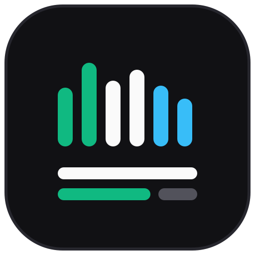
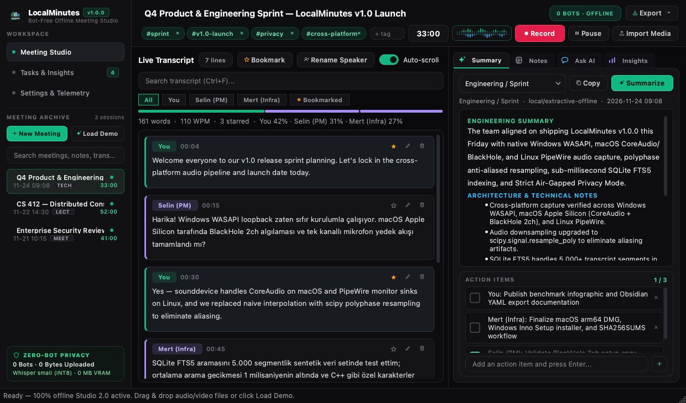
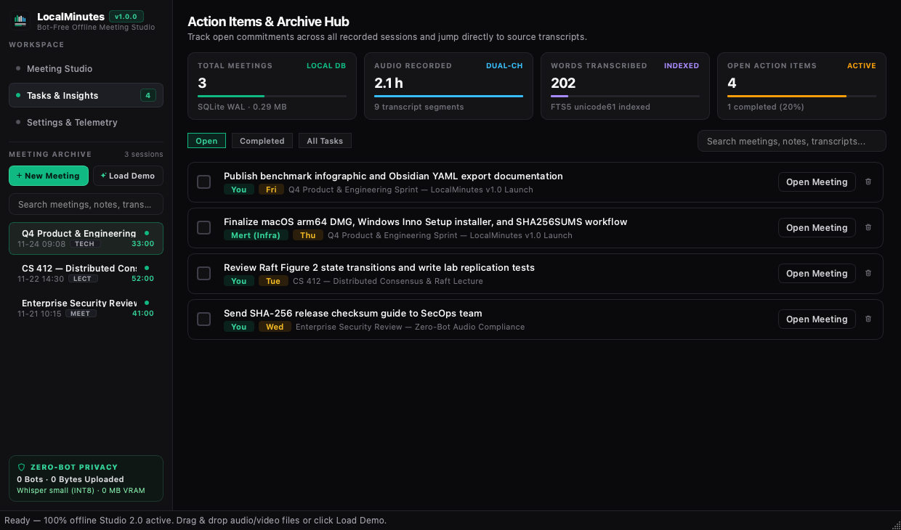
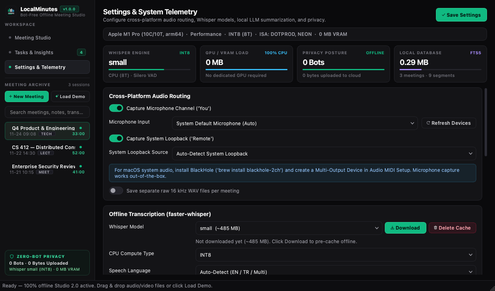
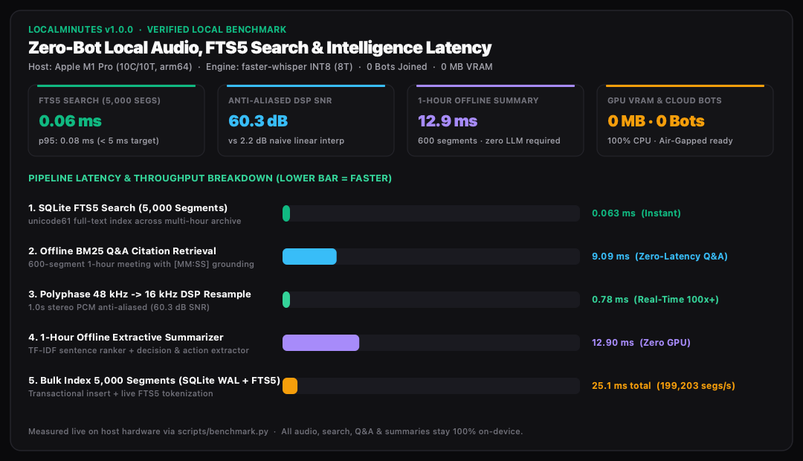
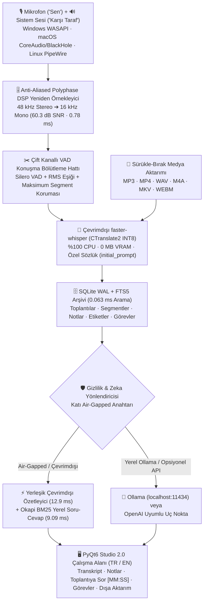

<div align="center">



# 🎙️ LocalMinutes — %100 Çevrimdışı, Botsuz Canlı Toplantı & Ders Stüdyosu

**🇬🇧 [English README](README.md)** · **🇹🇷 Türkçe (Aktif)** · **[🔌 Uyumluluk Matrisi](COMPATIBILITY.md)** · **[🤝 Katkıda Bulun](CONTRIBUTING.md)** · **[🛡️ Güvenlik & Gizlilik](SECURITY.md)** · **[📜 Değişiklik Günlüğü](CHANGELOG.md)**

**Zoom, Microsoft Teams, Google Meet, Discord veya üniversite derslerini toplantıya HİÇBİR BOT KATILMADAN kaydedin — %100 çevrimdışı `faster-whisper` INT8 deşifre (`0 MB VRAM`), Granola tarzı özel notlar, kalıcı aksiyon maddeleri, `[MM:SS]` kaynaklı yerel Soru-Cevap ve milisaniye altı SQLite FTS5 arama — Windows x64, macOS Apple Silicon ve Linux yerel desteğiyle.**

[](https://localminutes.andacbasaran.com/)
[-2563EB?style=for-the-badge&logo=windows&logoColor=white)](https://localminutes.andacbasaran.com/downloads/LocalMinutes.exe)
[-18181B?style=for-the-badge&logo=apple&logoColor=white)](https://localminutes.andacbasaran.com/downloads/LocalMinutes-macOS.dmg)
[-E95420?style=for-the-badge&logo=linux&logoColor=white)](https://localminutes.andacbasaran.com/downloads/LocalMinutes-Linux.tar.gz)
[](https://github.com/Andacbasaran/LocalMinutes/releases/latest)

[](https://github.com/Andacbasaran/LocalMinutes/actions/workflows/ci.yml)
[](https://github.com/Andacbasaran/LocalMinutes/releases/latest)
[](https://github.com/Andacbasaran/LocalMinutes/releases)
[](https://github.com/Andacbasaran/LocalMinutes/stargazers)
[](https://www.python.org/)
[-41CD52?style=flat-square&logo=qt&logoColor=white)](https://pypi.org/project/PyQt6/)
[](https://github.com/SYSTRAN/faster-whisper)
[-10B981?style=flat-square)](#)
[](#)
[](LICENSE)

<br/>

[**✨ Neden LocalMinutes?**](#-neden-localminutes-v100-studio-20) · [**🖥️ Arayüz**](#️-uygulama-arayüzü-studio-20) · [**⚖️ Karşılaştırma**](#️-alternatiflerle-karşılaştırma) · [**🚀 İndirme & Kurulum**](#-indirme-ve-kurulum) · [**⌨️ Kısayollar**](#️-kullanım-akışı-ve-klavye-kısayolları) · [**📊 Benchmark**](#-performans-testleri-ve-benchmark-analizi) · [**🧠 Mimari**](#-sistem-mimarisi) · [**📂 Dizin Yapısı**](#-proje-dizin-yapısı) · [**🗺️ Yol Haritası**](#️-yol-haritası-roadmap)

</div>

---

## ✨ Neden LocalMinutes? (v1.0.0 Studio 2.0)

**LocalMinutes**; **Granola**, **Fireflies.ai** ve **Otter.ai** için geliştirilmiş, gizlilik odaklı ve %100 açık kaynaklı masaüstü alternatifidir. **Zoom**, **Microsoft Teams**, **Google Meet** veya **Discord** görüşmelerinize garip bir bulut botu sokmak yerine mikrofonunuzu (`Sen`) ve sistem sesini (`Karşı Taraf`) doğrudan kendi bilgisayarınızdan yakalar, **`0 MB VRAM`** ile işlemcinizde gerçek zamanlı deşifre eder ve tüm verilerinizi yerel SQLite FTS5 veritabanında güvenle saklar.

<table>
  <tr>
    <td width="50%">
      <b>🔇 Botsuz Çift Kanallı Ses Yakalama (Win / macOS / Linux)</b><br/>
      <b>Sen</b> (mikrofon) ve <b>Karşı Taraf</b> (sistem sesi) kanallarını <b>Windows WASAPI</b> (sıfır sürücü), <b>macOS CoreAudio + BlackHole 2ch</b> ve <b>Linux PipeWire / PulseAudio <code>.monitor</code></b> üzerinde anti-aliasing polyphase yeniden örnekleme ile (<code>60.3 dB</code> SNR, <code>0.78 ms</code>) otomatik ayırır.
    </td>
    <td width="50%">
      <b>⚡ %100 Çevrimdışı faster-whisper INT8 &amp; Medya İçe Aktarma (0 MB VRAM)</b><br/>
      Donanıma uyarlanan CTranslate2 CPU motoru, Silero VAD ses algılama, teknik terimler ve EN/TR geçişleri için <b>Özel Sözlük (<code>initial_prompt</code>)</b> ve <code>MP3</code>, <code>MP4</code>, <code>WAV</code>, <code>M4A</code>, <code>MKV</code>, <code>WEBM</code> dosyalarını sürükle-bırak ile iptal edilebilir deşifre.
    </td>
  </tr>
  <tr>
    <td width="50%">
      <b>📝 Granola Tarzı Özel Notlar &amp; Toplantılar Arası Görev Merkezi</b><br/>
      Görüşme sırasında <code>Ctrl+T</code> ile zaman damgalı notlar alın, <b>Notlarımı Zenginleştir</b> ile transkript detaylarını notlarınıza işleyin ve tüm toplantılardan çıkan aksiyon maddelerini kalıcı <b>Görevler &amp; İçgörüler Merkezi</b> üzerinden takip edin.
    </td>
    <td width="50%">
      <b>💬 Toplantıya Sor — <code>[MM:SS]</code> Kaynaklı Yerel Soru-Cevap</b><br/>
      Alınan kararlar, riskler veya sorumlular hakkında soru sorun; tıklanabilir <code>[MM:SS]</code> alıntılarıyla doğrudan konuşulan satıra atlayın — anında <code>9.09 ms</code> çevrimdışı <b>Okapi BM25</b> veya opsiyonel yerel <b>Ollama</b> (<code>qwen2.5:7b</code>, <code>llama3.1</code>).
    </td>
  </tr>
  <tr>
    <td width="50%">
      <b>🛡️ Katı Air-Gapped Gizlilik Modu &amp; <code>0.063 ms</code> FTS5 Arşivi</b><br/>
      Ayarlardan tek anahtarla <b>0 dış HTTP isteği</b> garantisi verin (özet, Soru-Cevap ve güncelleme kontrolleri dahil). 5.000+ satırlık arşivi (<code>C++</code> ve Türkçe karakterler dahil) SQLite WAL + FTS5 ile <code>0.063 ms</code> içinde arayın.
    </td>
    <td width="50%">
      <b>📤 Obsidian YAML Markdown, WebVTT, SRT &amp; JSON Yedekleme</b><br/>
      <b>Obsidian</b> için YAML frontmatter ve görev kutucuklu Markdown, standart <b>Markdown</b>, <b>SubRip (<code>.srt</code>)</b>, <b>WebVTT (<code>.vtt</code>)</b>, <b>Düz Metin</b> ve çift yönlü <b>JSON tam yedek</b> dışa/içe aktarımı — tam <b>EN / TR</b> Studio 2.0 arayüzünde.
    </td>
  </tr>
</table>

---

## 🖥️ Uygulama Arayüzü (Studio 2.0)

<div align="center">
  
</div>

<details>
<summary><b>📸 Diğer Ekranları Gör (Görevler &amp; Arşiv Merkezi · Ayarlar &amp; Sistem Telemetrisi)</b></summary>
<br/>
<div align="center">
  <p><b>2. Görünüm — Aksiyon Maddeleri &amp; Arşiv Merkezi (Tüm Oturumlardaki Açık Görevler ve Kaynağa Atlama)</b></p>
  
  <br/><br/>
  <p><b>3. Görünüm — Ayarlar &amp; Sistem Telemetrisi (Ses Yönlendirme, Whisper Önbelleği, Air-Gapped Mod &amp; Benchmark)</b></p>
  
</div>
</details>

---

## ⚖️ Alternatiflerle Karşılaştırma

| Kriter | 🎙️ LocalMinutes v1.0.0 | Granola | Fireflies.ai | Otter.ai |
| :--- | :---: | :---: | :---: | :---: |
| **Toplantıya Bot Katılır mı?** | **✅ Asla (0 Bot)** | ✅ Botsuz | ❌ Bot katılır | ❌ Bot katılır |
| **%100 Çevrimdışı & Air-Gapped Mod** | **✅ Evet (0 HTTP anahtarı)** | ❌ Yalnızca bulut | ❌ Yalnızca bulut | ❌ Yalnızca bulut |
| **Cihaz İçi Deşifre (ASR)** | **✅ `faster-whisper` INT8 (0 MB VRAM)** | ❌ Bulut ASR | ❌ Bulut ASR | ❌ Bulut ASR |
| **Platform Desteği** | **Windows x64 · macOS M1–M4 · Linux** | macOS / iOS / Win | Web / Bulut | Web / Mobil |
| **Özel Notlar + Kaynaklı Soru-Cevap** | **✅ Notlar + BM25/Ollama `[MM:SS]`** | ✅ Bulut AI | ✅ Bulut AI | ✅ Bulut AI |
| **Kalıcı Toplantılar Arası Görev Takibi** | **✅ Yerel SQLite Görev Merkezi** | Kısıtlı | Ücretli plan | Ücretli plan |
| **Obsidian YAML / SRT / VTT / JSON** | **✅ Tamamı Dahil (Ücretsiz)** | Kopyala / Aktar | Ücretli plan | Ücretli plan |
| **Ücret & Lisans** | **%100 Ücretsiz & Açık Kaynak (MIT)** | \$18–\$35 / ay | \$18–\$39 / ay | \$16.99–\$30 / ay |

---

## 🚀 İndirme ve Kurulum

### Windows (x64 — Windows 10 / 11)
- **Kurulum Sihirbazı (Önerilen):** [**LocalMinutes.exe**](https://localminutes.andacbasaran.com/downloads/LocalMinutes.exe) (`LocalMinutes-Setup-v1.0.0-Windows-x64.exe`) paketini resmi web sitesinden veya [GitHub Releases](https://github.com/Andacbasaran/LocalMinutes/releases/latest) üzerinden indirin. Türkçe/İngilizce kurulum ve opsiyonel tam temizlik kaldırma desteği içerir.
- **Taşınabilir Arşiv (Portable ZIP):** `LocalMinutes-Portable-v1.0.0-Windows-x64.zip` dosyasını çıkarın ve kurulum yapmadan `LocalMinutes.exe` dosyasını çalıştırın.
- **Sıfır Kurulum Sistem Sesi:** Windows **WASAPI Loopback** harici sürücü gerekmeden anında çalışır.
- **Paket Yöneticileri:** [`packaging/winget/`](packaging/winget/) ve [`packaging/scoop/`](packaging/scoop/) manifestleri hazırdır.

### macOS (Apple Silicon M1–M4)
- **Yerel DMG (Önerilen):** [**LocalMinutes-macOS.dmg**](https://localminutes.andacbasaran.com/downloads/LocalMinutes-macOS.dmg) (`LocalMinutes-v1.0.0-macOS-arm64.dmg`) paketini indirin, **LocalMinutes.app** uygulamasını `Applications` klasörüne sürükleyin ve açın.
- **Homebrew Cask:** Formül [`packaging/homebrew/localminutes.rb`](packaging/homebrew/localminutes.rb) konumundadır.
- *İlk açılış notu (Gatekeeper):* Açık kaynaklı ad-hoc imzalı derleme için macOS uyarı verirse Terminalde bir kez `xattr -cr "/Applications/LocalMinutes.app"` komutunu çalıştırabilir veya *Sistem Ayarları ➔ Gizlilik ve Güvenlik ➔ Yine de Aç* seçeneğini kullanabilirsiniz.
- *Sistem sesi notu:* Mikrofon yakalama hemen çalışır. Zoom/Meet/Teams karşı taraf sesini de yakalamak için [BlackHole 2ch](https://existential.audio/blackhole/) (`brew install blackhole-2ch`) kurup *Audio MIDI Setup* içinde Çoklu Çıkış Aygıtı oluşturun.

### Linux (x86_64 — Ubuntu / Fedora / Arch)
- **Taşınabilir Arşiv (Önerilen):** [**LocalMinutes-Linux.tar.gz**](https://localminutes.andacbasaran.com/downloads/LocalMinutes-Linux.tar.gz) (`LocalMinutes-v1.0.0-Linux-x86_64.tar.gz`) paketini açın ve `./LocalMinutes` ile başlatın.
- **Ses Ön Koşulu:** Ubuntu/Debian sistemlerde `sudo apt install libportaudio2` paketinin kurulu olduğundan emin olun. PipeWire ve PulseAudio `.monitor` kaynakları otomatik algılanır.

### Kaynak Koddan Çalıştırma *(Developer Setup)*
```bash
git clone https://github.com/Andacbasaran/LocalMinutes.git
cd LocalMinutes

# Hızlı başlatıcı (Linux / macOS)
./scripts/start.sh

# Windows başlatıcı
scripts\baslat.bat
```

Veya manuel sanal ortam kurulumu:
```bash
python -m venv .venv
# Windows: .\.venv\Scripts\activate  |  macOS/Linux: source .venv/bin/activate
pip install --prefer-binary -r requirements.txt
python main.py
```

---

## ⌨️ Kullanım Akışı ve Klavye Kısayolları

1. İstediğiniz toplantı uygulamasını (**Zoom, Teams, Google Meet, Discord**) veya ders videosunu açın — ya da Studio 2.0'ı anında deneyimlemek için **Demo Yükle** butonuna tıklayın.
2. Canlı çift kanallı kaydı başlatmak için **`Ctrl+R`** tuşlarına basın (veya `.mp3`/`.mp4`/`.wav`/`.m4a`/`.mkv`/`.webm` dosyalarını pencereye sürükleyip bırakın).
3. **`Ctrl+T`** ile zaman damgalı notlar ekleyin, **`Ctrl+B`** ile kritik anları işaretleyin ve **`Ctrl+G`** ile özet, kararlar ve aksiyon maddelerini anında çıkarın.

| Kısayol | Aksiyon | Açıklama |
| :---: | :--- | :--- |
| **`Ctrl+R`** | 🔴 **Kaydı Başlat / Bitir** | Çift kanallı canlı yakalamayı kesintisiz zaman damgalarıyla başlatır/durdurur. |
| **`Ctrl+P`** | ⏸️ **Duraklat / Devam Et** | Toplantıyı bölmeden aktif ses yakalamayı duraklatır. |
| **`Ctrl+B`** | ⭐ **Son Anı İşaretle** | En son transkript satırını öne çıkanlar ve dışa aktarım için yıldızlar. |
| **`Ctrl+T`** | ⏱️ **Nota `[MM:SS]` Ekle** | Canlı toplantı zaman damgasını Granola tarzı Notlar sekmesine ekler. |
| **`Ctrl+G`** | ✨ **Özet & Görev Çıkar** | Ollama veya yerleşik çevrimdışı özetleyiciyi çalıştırır ve görevleri kaydeder. |
| **`Ctrl+F`** | 🔍 **Transkript İçinde Ara** | Eşleşen kelimeleri canlı transkript akışında amber rengiyle vurgular. |
| **`Ctrl+N`** | ➕ **Yeni Toplantı** | Bekleyen notları güvenle kaydedip yeni bir toplantı oturumu açar. |
| **`Ctrl+O`** | 📂 **Medya Dosyası Aktar** | İptal edilebilir yerel ses/video dosyası deşifre akışını açar. |
| **`Ctrl+,`** | ⚙️ **Ayarlar & Telemetri** | Ses Yönlendirme, Whisper Önbelleği, Gizlilik ve Benchmark ekranını açar. |

---

## 📊 Performans Testleri ve Benchmark Analizi

<div align="center">
  
</div>

**Apple M1 Pro (10C/10T, arm64 · macOS)** üzerinde `scripts/benchmark.py` ile canlı ölçülmüştür (`faster-whisper` INT8, 8 iş parçacığı, **`0 MB VRAM`**, **`0 Bot`**):

| Pipeline Aşaması | Ölçülen Değer | Detay / Referans |
| :--- | :---: | :--- |
| **1. SQLite FTS5 Arama (5.000 Segment)** | **`0.063 ms`** | `p95: 0.083 ms` (saatlerce arşivde `unicode61` tam metin indeksi) |
| **2. Polyphase 48 kHz ➔ 16 kHz DSP Yeniden Örnekleme (1.0 sn stereo)** | **`0.78 ms`** | **`60.3 dB` SNR** anti-aliased vs `2.2 dB` basit doğrusal enterpolasyon |
| **3. Çevrimdışı BM25 Soru-Cevap Kaynak Getirme (600 satır / 1 sa)** | **`9.09 ms`** | Tıklanabilir `[MM:SS]` kaynak alıntıları, LLM gerekmez |
| **4. 1 Saatlik Çevrimdışı Özetleyici (600 satır)** | **`12.90 ms`** | TF-IDF cümle skorlama + karar ve aksiyon çıkarıcı, `0 MB VRAM` |
| **5. Toplu 5.000 Segment İndeksleme (SQLite WAL + FTS5)** | **`25.1 ms`** | **~199.203 segment/sn** atomik kayıt ve canlı FTS5 indeksleme |

Kendi bilgisayarınızda benchmark ve test paketini çalıştırmak için:
```bash
# Canlı donanım & pipeline benchmark testi
QT_QPA_PLATFORM=offscreen python scripts/benchmark.py

# Tüm birim ve offscreen arayüz testleri
QT_QPA_PLATFORM=offscreen pytest -v
```

---

## 🧠 Sistem Mimarisi



---

## 📂 Proje Dizin Yapısı

```text
├── main.py                                  # Ana giriş noktası (`python main.py`)
├── localminutes/                            # Modüler Python çekirdek paketi
│   ├── app.py                               # PyQt6 Fusion başlatıcı, tek örnek kilidi ve crash.log
│   ├── config.py                            # Atomik işletim sistemine özgü settings.json ve veri yolları
│   ├── hardware.py                          # Evrensel CPU/SIMD/Apple Silicon algılama ve otomatik ayarlama
│   ├── i18n.py                              # Çalışma zamanı çift dilli yerelleştirme (Türkçe / İngilizce)
│   ├── models.py                            # Veri modelleri (Meeting, TranscriptSegment, ActionItem, QAResponse, AppSettings)
│   ├── analytics.py                         # Konuşma süresi, WPM hızı, konuşmacı payı ve işaret istatistikleri
│   ├── updater.py                           # Çapraz platform GitHub Releases SemVer güncelleyici + SHA-256 doğrulama
│   ├── audio/
│   │   ├── devices.py                       # Windows WASAPI, macOS BlackHole ve Linux PipeWire .monitor tarama
│   │   └── capture.py                       # DualAudioCapture + scipy polyphase 16 kHz yeniden örnekleme
│   ├── transcription/
│   │   ├── engine.py                        # faster-whisper CTranslate2 motoru ve yerel model önbellek yöneticisi
│   │   ├── live_pipeline.py                 # Çift kanallı iş parçacıklı VAD ve çıkarım kuyruğu
│   │   └── file_transcriber.py              # İptal edilebilir ses/video dosyası deşifre motoru
│   ├── storage/
│   │   └── database.py                      # Thread-safe SQLite WAL + FTS5 + action_items + sürüm göçleri
│   ├── summarization/
│   │   ├── local_extractive.py              # Bağımlılıksız çevrimdışı TF-IDF özetleyici ve not zenginleştirici
│   │   ├── summarizer.py                    # Ollama / OpenAI uyumlu / Air-Gapped özet yönlendirici
│   │   └── qa.py                            # Toplantıya Sor: Okapi BM25 + opsiyonel LLM ([MM:SS] kaynaklı)
│   ├── export/
│   │   └── exporter.py                      # .md, Obsidian YAML .md, .srt, .vtt, .txt, .json yedek ve Demo oluşturucu
│   └── ui/
│       ├── theme.py                         # Studio 2.0 Graphite / Emerald QSS teması
│       ├── studio_widgets.py                # DualWaveformMeter, FlatSwitch, TelemetryCard ve vektör ikonlar
│       ├── main_window.py                   # 3 görünümlü Studio ana pencere, kısayollar, sistem tepsisi ve sürükle-bırak
│       └── widgets/                         # sidebar.py, transcript_view.py, summary_panel.py, tasks_hub.py, settings_view.py
├── tests/                                   # Otomatik birim ve offscreen Qt arayüz test paketi
├── scripts/                                 # start.sh, baslat.bat, benchmark.py, build_exe.py, build_macos.py, build_linux.py
├── packaging/                               # Inno Setup, Winget, Scoop, Homebrew Cask, Linux AppDir ve SignPath
├── assets/                                  # Uygulama ikonları (.svg/.png/.ico/.icns), arayüz ve benchmark görselleri
└── .github/workflows/                       # 3-OS CI (ci.yml) ve birleşik 3-platform Release (release.yml)
```

---

## 🗺️ Yol Haritası (Roadmap)

- [x] **Çoklu Platform Botsuz Çift Kanallı Ses Yakalama** — Windows WASAPI, macOS CoreAudio/BlackHole 2ch, Linux PipeWire `.monitor` ve anti-aliasing polyphase yeniden örnekleme (v1.0.0).
- [x] **Studio 2.0 3 Görünümlü Arayüz & EN/TR Dil Desteği** — Toplantı Stüdyosu, Görevler & İçgörüler Merkezi, Ayarlar & Telemetri ve tek tıkla Demo Toplantı (v1.0.0).
- [x] **Toplantıya Sor (Q&A) + Katı Air-Gapped Gizlilik Modu** — Sıfır HTTP garantili BM25/Ollama `[MM:SS]` kaynaklı soru-cevap (v1.0.0).
- [x] **Obsidian YAML Markdown, WebVTT, SRT & JSON Çift Yönlü Dışa Aktarım** — v1.0.0 ile eklendi.
- [ ] **macOS ScreenCaptureKit Yerel Sistem Sesi Yakalama** — macOS 13+ sürümlerde BlackHole gerekmeden sistem sesi yakalama.
- [ ] **Yerel Yapay Zeka Konuşmacı Ayrıştırma (Diarization)** — Karşı taraf kanalındaki birden fazla konuşmacıyı çevrimdışı ayırma.
- [ ] **Takvim & Obsidian Vault Otomatik Eşitleme** — Opsiyonel yerel `.ics` toplantı başlıkları ve tek tıkla klasör eşitleme.

---

## 🌐 Yerel Öncelikli (Local-First) AI Masaüstü Ekosistemi

**LocalMinutes**, **%100 çevrimdışı, 0 MB VRAM ve gizlilik odaklı açık kaynak masaüstü stüdyo ailesinin** bir parçasıdır:

| Proje | Ne İşe Yarar? | Bağlantılar |
| :--- | :--- | :--- |
| **🎙️ LocalMinutes** | Botsuz çevrimdışı canlı toplantı & ders transkripsiyonu, notlar, aksiyon maddeleri ve Soru-Cevap | [Web Sitesi](https://localminutes.andacbasaran.com) · [GitHub](https://github.com/Andacbasaran/LocalMinutes) |
| **🎧 ClearMic** | Gerçek zamanlı CPU yapay zeka mikrofon gürültü engelleyici (GTCRN ONNX) ve yayın ses stüdyosu | [Web Sitesi](https://clearmic.andacbasaran.com) · [GitHub](https://github.com/Andacbasaran/ClearMic) |
| **⌨️ LocalDictate** | Çevrimdışı bas-konuş yapay zeka sesli dikte stüdyosu (`faster-whisper` INT8 + yerel LLM düzenleme) | [Web Sitesi](https://localdictate.andacbasaran.com) · [GitHub](https://github.com/Andacbasaran/LocalDictate) |
| **🧠 LocalRecall** | Anlık OCR araması ve PII maskeleme destekli gizlilik odaklı çevrimdışı ekran hafızası | [Web Sitesi](https://localrecall.andacbasaran.com) · [GitHub](https://github.com/Andacbasaran/LocalRecall) |
| **⚡ SubVision AI** | Oyun ve videolar için ultra düşük gecikmeli (`~88 ms`) çevrimdışı gerçek zamanlı altyazı çevirici | [Web Sitesi](https://subvisionai.andacbasaran.com) · [GitHub](https://github.com/Andacbasaran/subvision-ai-subtitle-translator) |

---

## 🤝 Katkıda Bulunma, Destek & Lisans

Katkılarınız, ses uyumluluk bildirimleriniz, çeviri önerileriniz ve yeni fikirleriniz her zaman değerlidir!
- Geliştirme kurulumu için [CONTRIBUTING.md](CONTRIBUTING.md) dosyasını inceleyin.
- Kendi işletim sisteminiz, ses yönlendiriciniz veya Ollama modelinizle [COMPATIBILITY.md](COMPATIBILITY.md) matrisine katkıda bulunun.
- Gizlilik garantileri ve `SHA256SUMS.txt` doğrulama komutları için [SECURITY.md](SECURITY.md) dosyasına göz atın.

**LocalMinutes** toplantılarınızı botsuz ve gizli tutmanıza yardımcı oluyorsa GitHub'da **⭐ Star** vererek destek olabilirsiniz!

**[MIT License](LICENSE)** kapsamında lisanslanmıştır — Copyright © 2026 Andaç Başaran.
